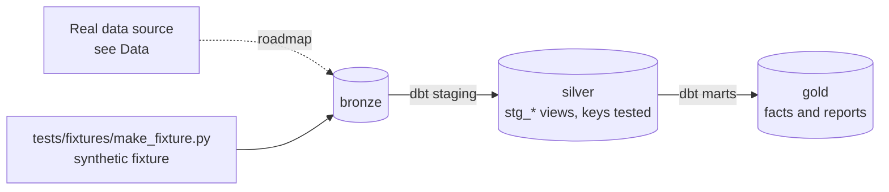

# Hourly Load Forecasting & Ops Reports

[](https://github.com/Saigwe/load-forecasting-ops/actions/workflows/ci.yml)

> Half-hourly national demand loaded incrementally with a 5-year backfill, a day-ahead forecast benchmarked against a naive baseline, forecast accuracy tracked over time, and a morning ops report with no manual steps.

**Author:** Stanley Igwe, Lead Data (Analytics) Engineer · [Portfolio](https://saigwe.github.io)
**Stack:** Airflow or Dagster · dbt Core · LightGBM or Prophet · DuckDB · Slack or email report
**Status:** 🚧 Scaffolded. Fixture pipeline passes: `dbt build` 13/13. See [Roadmap](#roadmap).

Project 19 of my portfolio plan. At a Nigerian electricity distribution company I produced daily fault and hourly load reporting and energy-consumption trend analysis. This repo rebuilds the problem on public and synthetic data. No employer or client data, code or logic is used.

---

## 90-second summary
| | |
|---|---|
| **Problem** | TODO: one sentence on the business problem. |
| **What I built** | TODO: fill in as the roadmap lands. |
| **Why it matters** | TODO: the decision this enables, in the user's words. |
| **Proof** | TODO: link to [Numbers](#numbers), with every claim reproducible. |

## Architecture


## Data
Real data: the [NESO data portal](https://www.neso.energy/data-portal) (formerly National Grid ESO) historic GB demand, half-hourly, with weather from the [Open-Meteo API](https://open-meteo.com/). CI uses a synthetic half-hourly demand and daily weather fixture.

| Bronze table (fixture) | Rows |
|---|---|
| `bronze.demand` | one per `30min` period, 2025-01-01 00:00:00 to 2025-03-31 23:30:00 |
| `bronze.weather` | one per `D` period, 2025-01-01 to 2025-03-31 |

## Data model (gold layer, first cut)
| Model | Purpose |
|---|---|
| `rpt_daily_demand` | Report model |
| `rpt_naive_forecast_accuracy` | Baseline to beat: forecast each day's average demand with the same weekday last week. |

## Tests in place
- Staging: `unique` / `not_null` on every key, and `relationships` on every foreign key
- Marts: grain tests (`unique_combination`) and accepted values
- Business rules: `assert_48_settlement_periods_per_day`

## Numbers
*(Fill from real runs. Never estimate.)*
| Metric | Value |
|---|---|
| Rows processed (real data) | _tbd_ |
| dbt models / tests | _tbd_ |
| `dbt build` runtime | _tbd_ |

## How to run
Requires **Python 3.12** (what CI uses) and `make`, or run the commands in the `Makefile` by hand.
```bash
python -m venv .venv && source .venv/bin/activate   # Windows: .venv\Scripts\activate
pip install -r requirements.txt
make fixture-all   # synthetic fixture -> dbt build (used in CI)
```

## Roadmap
- [x] Scaffold: synthetic fixture, staging with key tests, first marts and business-rule tests, CI
- [ ] Incremental daily loads from NESO; backfill five years
- [ ] Join Open-Meteo weather
- [ ] Day-ahead forecast (LightGBM) vs the naive same-day-last-week baseline
- [ ] Forecast accuracy (MAPE) by month, tracked over time
- [ ] Automated morning ops report posted to Slack; the DAG running green for 30 days
- [ ] Fill in [Numbers](#numbers) and the [design doc](docs/design_doc.md)
- [ ] 3-minute Loom walkthrough

## Interview topics this project prepares
- Scheduling and backfills
- Forecast evaluation
- Time-series features
- Operational reporting

## Data and licence
- **Fixture:** synthetic, generated with a fixed seed by `tests/fixtures/make_fixture.py` from `fixture_spec.yml`. It describes no real company or person.
- **Real data:** see [Data](#data) for each source's own licence and terms.
- **Code:** MIT (see `LICENSE`).
