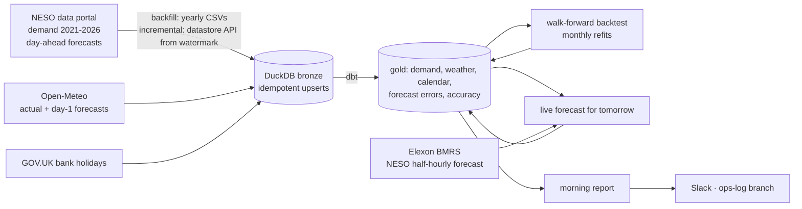

# Load Forecasting Ops: GB Day-Ahead Demand

[](https://github.com/Saigwe/load-forecasting-ops/actions/workflows/ci.yml)
[](https://github.com/Saigwe/load-forecasting-ops/actions/workflows/daily.yml)

> Five years of half-hourly GB national demand from NESO, backfilled once and then loaded incrementally. Open-Meteo weather (with day-ahead forecasts as they were issued) and bank holidays are joined in. A LightGBM day-ahead forecast is tested walk-forward against the naive same-day-last-week baseline and against NESO's own published forecast. A daily DAG forecasts tomorrow, scores yesterday and writes a morning report. Over 45,031 half-hours, the model that corrects NESO's forecast beats NESO: 2.69% vs 2.78% MAPE.

**Author:** Stanley Igwe, Lead Data (Analytics) Engineer · [Portfolio](https://saigwe.github.io)
**Stack:** Python · DuckDB · dbt Core (unit tests) · LightGBM · NESO data portal (CKAN API) · Elexon BMRS API · Open-Meteo · GitHub Actions (CI + daily schedule) · Slack webhook
**Status:** Core build complete on real data; the daily DAG runs on GitHub Actions. See [Roadmap](#roadmap).

Project 19 of my portfolio plan. At a Nigerian electricity distribution company I produced daily fault and hourly load reporting and energy-consumption trend analysis. This repo rebuilds that operations rhythm on public GB data. No employer data is used.

---

## 90-second summary
| | |
|---|---|
| **Problem** | Control rooms need tomorrow's demand by mid-morning, an honest view of how good that forecast has been, and a report that arrives every day without anyone running it. |
| **What I built** | Incremental, idempotent loads with a five-year backfill. dbt models that handle clock-change days (46 and 50 settlement periods). A walk-forward backtest that only uses what was known at 09:45 the day before, guarded by a leakage test. A daily DAG on GitHub Actions: forecast tomorrow, score yesterday, post the report, and keep the forecast log on its own branch. |
| **Why it matters** | It's measured against the professional benchmark, NESO's own day-ahead forecast, not just a naive baseline. Starting from NESO's forecast and learning its systematic errors beats it in 23 of 31 months. |
| **Proof** | [Numbers](#numbers), from the real backfill and backtest; the daily run's log and reports are on the [`ops-log` branch](https://github.com/Saigwe/load-forecasting-ops/tree/ops-log). |

## Architecture


## Data
| Source | What | Volume |
|---|---|---|
| [NESO historic demand](https://www.neso.energy/data-portal/historic-demand-data) | Half-hourly national demand (ND), Oct 2021 to the latest published day | 87,888 half-hours (the file lags about three weeks) |
| [NESO day-ahead forecast performance](https://www.neso.energy/data-portal/day-ahead-half-hourly-demand-forecast-performance) | NESO's day-ahead forecast per half-hour (published 09:45 the day before) with outturn, from April 2021 | 97,645 half-hours, with outturn up to this morning |
| [Elexon BMRS](https://bmrs.elexon.co.uk/) | NESO's latest half-hourly day-ahead forecast for tomorrow (the NESO portal only shows 11 points live) | 48 per day |
| [Open-Meteo](https://open-meteo.com/) | Temperature, solar radiation and wind at 9 GB cities, population-weighted: archive and day-1 forecasts (from March 2024) | 44,304 / 23,167 hours |
| [GOV.UK bank holidays](https://www.gov.uk/bank-holidays.json) | England and Wales, and Scotland | 177 |

**Upstream quirks handled:**
- NESO's yearly files use three date formats (`01-JAN-2021`, `01-Jan-23`, `2025-01-01`). A lenient day-first parser silently turned 10 January into 1 October, so each format is now parsed explicitly and unit-tested.
- The current-year file is replaced daily, and the last day is re-read on every incremental load because NESO revises it.

## Forecasting setup (no leakage)
Each forecast for day D is made as at 09:45 on D−1, when NESO publishes its own:
- **Demand:** up to 08:00 on D−1, plus D−2, D−7 and D−14 at the same settlement period.
- **Weather:** day-ahead forecasts for D. Training years before March 2024 use the weather that actually happened, because archived forecasts start then.
- **Calendar:** day of week, bank holidays, time of year, and a trend term (rooftop solar keeps growing).

There are two models:
- **`lgbm_day_ahead`** forecasts demand directly.
- **`lgbm_neso_residual`** starts from NESO's published forecast and learns its systematic error from the same features. NESO's forecast is public at 09:45, so this is fair; traders do exactly this.

**Backtest:** walk-forward with a monthly refit on everything known two days before the month. Every forecast is stamped `issued_at`, and a dbt test fails if any forecast was issued on or after its target day.

## Numbers
**Backtest, April 2024 to October 2026** (45,031 half-hours scored by every method; [monthly](results/), `gold.rpt_forecast_accuracy_monthly`):

| Method | MAPE | MAE | Bias | Best month |
|---|---:|---:|---:|---:|
| **NESO forecast + learned error** (`lgbm_neso_residual`) | **2.69%** | 664 MW | −22 MW | 23 of 31 |
| NESO day-ahead (published) | 2.78% | 687 MW | −18 MW | 8 of 31 |
| LightGBM standalone (`lgbm_day_ahead`) | 4.43% | 1,093 MW | −6 MW | 0 |
| Naive: same period, same weekday last week | 8.14% | 2,047 MW | −11 MW | 0 |

- **By year:** the residual model beats NESO every year: 2.39% vs 2.44% (2024), 2.55% vs 2.69% (2025), and 3.13% vs 3.22% (2026 so far). Both are getting worse over time. NESO's own MAPE has risen from 1.93% in 2021 to 3.22% in 2026, as rooftop solar makes demand harder to forecast.
- **By season:** both are best in winter (2.09% vs 2.23%) and worst in summer (2.93% vs 3.01%), when solar matters most.
- **Standalone model:** it halves the naive error but is well behind NESO, which has the system operator's full information. That's why the residual approach is the useful one.

**Pipeline:**

| Step | Result |
|---|---|
| Backfill (5 years of demand, NESO forecasts, weather, holidays) | 52 s on first download; reruns 4 s (idempotent) |
| Incremental load | 1–3 s; only rows after each table's watermark, re-reading the last day |
| Clock changes | 10 days in the data with 46 or 50 settlement periods, all on the right Sundays (tested) |
| dbt build | 22 nodes (7 models, 14 data tests, 1 unit test) |
| Daily DAG | 55 s locally after the first load: load, dbt, forecast, dbt, report, save state |

**First live forecast,** issued 26 October 2026 for the 27th:

| Method | Peak | Time |
|---|---:|---|
| NESO + learned error | 35,293 MW | 17:30 |
| NESO | 35,300 MW | 17:30 |
| Standalone | 36,441 MW | 18:30 |

From here, the daily workflow scores each day once NESO publishes the outturn.

## Daily operations
[`ops/run_daily.py`](ops/run_daily.py) is the DAG, and [`.github/workflows/daily.yml`](.github/workflows/daily.yml) runs it at 10:15 UTC, after NESO's 09:45 forecast:
1. Load (a fresh runner backfills).
2. Restore the forecast log.
3. dbt build and tests.
4. Forecast tomorrow.
5. dbt again (the leakage test checks the new forecasts).
6. Morning report: status, yesterday's MAPE per method with the 30-day rolling figure, tomorrow's peak, and data freshness.
7. Save state to the `ops-log` branch.

Each step retries with backoff; a failed run goes red and GitHub emails the owner. The report posts to Slack when a `SLACK_WEBHOOK_URL` repository secret is set; until then it's in the run summary and on the `ops-log` branch.

**Status rules:**
- **GREEN:** all inputs are fresh and tomorrow's forecasts exist.
- **AMBER:** an input is stale, or yesterday's error was above its usual 90th percentile.
- **RED:** there's no forecast for tomorrow.

## How to run
Requires **Python 3.12** (what CI uses) and `make`.
```bash
python -m venv .venv && source .venv/bin/activate   # Windows: .venv\Scripts\activate
pip install -r requirements.txt
make all             # backfill, dbt, walk-forward backtest (~4 min), one daily run
make incremental     # what the daily run loads
make fixture-all     # synthetic bronze tables, offline: dbt, backtest, a daily run, tests (CI)
```

## Roadmap
- [x] Scaffold: fixture, staging with key tests, first marts, CI
- [x] Incremental daily loads from NESO (watermarks, idempotent upserts); backfill five years
- [x] Join Open-Meteo weather (actual, and day-ahead forecasts as issued)
- [x] Day-ahead forecast (LightGBM) vs the naive same-day-last-week baseline, and vs NESO's own forecast
- [x] Forecast accuracy (MAPE) by month, and daily with a 30-day rolling view
- [x] Automated morning report (Slack when a webhook secret is set) on a daily schedule
- [ ] The DAG running green for 30 days (it started 26 October 2026; check the badge and the `ops-log` branch)
- [ ] Probabilistic forecasts (quantiles) and peak-time accuracy
- [ ] 3-minute Loom walkthrough ([script ready](docs/walkthrough.md))

## Interview topics this project prepares
- Incremental loading: watermarks, idempotent upserts, late revisions, backfills
- Time-series evaluation without leakage: walk-forward refits, issue times, the right benchmark
- Energy domain: settlement periods and clock changes, embedded solar, NESO's day-ahead process
- Running a small production job: retries, status rules, state between runs, alerting

## Data and licence
- **NESO data:** NESO Open Data Licence. **Elexon BMRS:** Elexon's open data licence. **Open-Meteo:** CC BY 4.0. **GOV.UK:** Open Government Licence v3.0.
- **CI fixture:** synthetic, fixed seed.
- **Code:** MIT (see `LICENSE`).
